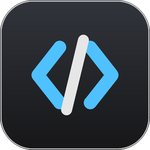
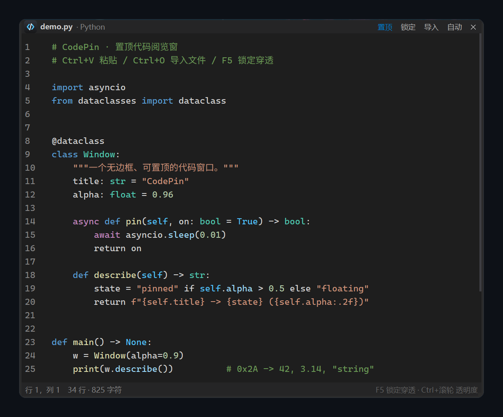

<div align="center">



# CodePin

**置顶代码阅览窗 · Always-on-Top Code Viewer for Windows**

把任意代码片段钉在屏幕最上层——无边框、可点击穿透、VSCode Dark+ 同款配色，
边看教程边敲代码，再也不用 Alt+Tab 来回切。

[](#)
[](#)
[](#-许可证)
[](#-技术实现)
[](#)

</div>



## 简介

看视频课、抄示例代码、对着别人的仓库改自己的工程时，代码窗口总在最下层，切来切去很烦。
CodePin 只做一件事：把代码贴在屏幕上、钉在最上层、不干扰你操作下面的窗口。

它只有 1300 行 Python，零第三方运行时依赖（仅标准库 tkinter），打包后是 **13 MB 的单文件 exe**，
启动约 1 秒；没有安装程序、没有后台服务、不联网、不写注册表，删掉目录即彻底卸载。

## 核心功能

| 功能 | 说明 |
| :--- | :--- |
| 📌 **窗口置顶** | 一键钉在最上层，选择会持久化到下次启动 |
| 🔓 **F5 锁定穿透** | 隐藏标题栏/状态栏只留代码，鼠标点击**穿透**到下层窗口，且**不抢焦点** |
| 🎨 **VSCode Dark+ 配色** | 与 VS Code 默认深色主题一致：注释 `#6A9955`、关键字 `#569CD6`、字符串 `#CE9178`、函数 `#DCDCAA`、类型 `#4EC9B0` |
| 🔤 **等宽字体** | 自动探测 Cascadia Mono → Consolas，按 DPI 缩放，中文注释正常回退 |
| ↔️ **横向阅读** | 代码不折行，支持 `Shift+滚轮`、`←/→` 方向键、底部滚动条三种横向滚动方式 |
| 🧠 **15 种语言高亮** | Python / JS / TS / C·C++ / Java / C# / Go / Rust / JSON / HTML / CSS / SQL / Shell / YAML / 纯文本，自动识别 |
| 🖼️ **粘贴即用** | `Ctrl+V` 直接粘贴，`Ctrl+O` 或「导入」按钮读文件，自动识别 UTF-8 / GBK 编码 |
| 🫥 **透明度** | `Ctrl+滚轮` 在 25%–100% 之间无级调节，方便对照底层文档 |
| 🪟 **无边框自绘** | 自绘标题栏、四边可拖拽缩放、行号栏、状态栏，整体 VSCode 观感 |

## 安装

### 方式一：自行打包（推荐，约 30 秒）

需要 Python 3.9+（含 tkinter，官方安装包默认自带）：

```bat
git clone https://github.com/MplusOasis/always-on-top-code-viewer.git
cd always-on-top-code-viewer
build.bat
```

产物为 `dist\CodePin.exe`，单文件、免安装、可随意拷贝。`build.bat` 会自动生成图标、安装打包依赖并编译。

### 方式二：直接跑源码

```bat
pythonw main.py
```

> 程序本身零第三方依赖；只有重新生成图标时才需要 `pip install pillow`。
> 也可在 [Releases](../../releases) 页下载维护者预编译的 `CodePin.exe`。

## 使用

### 三步开始

1. 打开 `CodePin.exe`，窗口默认出现在屏幕右侧；
2. 复制任意代码，`Ctrl+V` 粘贴（想整体替换就先 `Ctrl+A` 再粘贴），或点「导入」选文件；
3. 按 **F5** 进入锁定态——窗口只剩代码，你可以直接在下面的 IDE 里敲键盘，鼠标点击也不会落到它上面。

### 两种状态

| | 普通态 | 锁定态（F5） |
| :--- | :--- | :--- |
| 外观 | 标题栏 + 状态栏 + 滚动条 | 仅代码 + 1px 蓝色边框 |
| 鼠标 | 正常交互、可拖动缩放 | **点击穿透**，落到下层窗口 |
| 焦点 | 可输入、可粘贴 | **不抢焦点**，键盘输入直接进下层程序 |
| 滚动 | 滚轮 / 方向键 | 不可滚动（穿透的必然代价），按 F5 解锁后滚动再锁 |

> 锁定态下 `F5` 会临时注册为**系统级全局热键**，在任何窗口前台都能一键解锁；解锁即刻注销，不会长期占用。若 `F5` 已被其他软件注册，程序会提示并**拒绝进入锁定**，不会把自己锁死。

### 快捷键

| 按键 | 作用 |
| :--- | :--- |
| `F5` | 锁定 / 解锁（锁定后为全局热键） |
| `Esc` | 锁定态备用解锁键 |
| `←` / `→` | 横向滚动 3 字符 |
| `Ctrl+←` / `Ctrl+→` | 横向滚动 12 字符 |
| `Shift+滚轮` | 横向滚动 |
| `Ctrl+滚轮` | 调节不透明度 |
| `Ctrl+V` | 粘贴代码 |
| `Ctrl+O` | 导入文件 |
| `Ctrl+A` / `Ctrl+Shift+C` | 全选 / 复制全文 |
| `Ctrl+Q` | 退出 |

拖动标题栏移动窗口；拖左 / 右 / 下 / 右下边缘缩放窗口。

## 目录结构

```text
always-on-top-code-viewer/
├─ main.py              # 主程序：窗口装配、Win32 穿透、高亮引擎、热键线程（≈1300 行）
├─ make_icon.py         # 用 Pillow 代码生成 16–256px 多尺寸 .ico
├─ build.bat            # 一键打包：生成图标 → 装 PyInstaller → 编译单文件 exe
├─ requirements-dev.txt # 仅开发/打包期依赖（pillow、pyinstaller）
├─ assets/
│  ├─ icon.ico          # 应用图标（16/24/32/48/64/128/256）
│  ├─ icon.png          # 256px，README 使用
│  └─ icon32.png        # 标题栏内嵌图标
├─ docs/
│  └─ screenshot.png    # 界面截图
├─ LICENSE              # MIT
└─ README.md
```

运行期产生的 `build/`、`dist/`、`__pycache__/`、`*.spec` 已由 `.gitignore` 排除；
窗口位置等配置写在 `%APPDATA%\CodePin\state.json`，不在仓库内。

## 技术实现

**① 无边框 + 点击穿透** —— 关键在于两个扩展样式，缺一不可：

```python
hwnd  = GetAncestor(root.winfo_id(), GA_ROOT)          # 拿到真正的顶层 HWND
style = GetWindowLongPtrW(hwnd, GWL_EXSTYLE)
style |= WS_EX_TRANSPARENT | WS_EX_NOACTIVATE          # 穿透 + 永不抢焦点
SetWindowLongPtrW(hwnd, GWL_EXSTYLE, style)
SetWindowPos(hwnd, None, 0, 0, 0, 0, SWP_APPLY)        # 必须带 FRAMECHANGED 才生效
```

**② 为什么 F5 必须是全局热键** —— 穿透 + `NOACTIVATE` 之后窗口拿不到键盘焦点，
`bind("<F5>")` 永远不会触发。因此锁定态在**独立线程**里注册 `RegisterHotKey` 并跑消息循环，
命中后通过队列交回 Tk 主线程解锁：

```python
RegisterHotKey(None, 1, MOD_NOREPEAT, VK_F5)   # 仅锁定期间有效，解锁立即注销
while GetMessageW(byref(msg), None, 0, 0) > 0:
    if msg.message == WM_HOTKEY:
        queue.put(msg.wParam)
```

**③ 高亮引擎** —— 逐行状态机扫描，块注释与三引号字符串的**跨行状态**在行间传递；
字符串优先于注释、注释优先于关键字，避免 `"# 这不是注释"` 被误判成注释。
Token 生成 span 列表后批量 `tag_add` 上色，编辑时 debounce 180 ms 重扫。

**④ 行号栏对齐** —— 行号用第二个 `Text` 控件，必须与正文**同字体、同 spacing、同 pady**，
否则滚动几千行后会累积错位；滚动时用 `yview_moveto(first)` 同步比例。

## 常见问题

**Q：为什么锁定后不能滚动？**
`WS_EX_TRANSPARENT` 让整个窗口（含滚轮事件）都穿透给下层程序，这是"能点到下面的窗口"的前提。
需要滚动时按 `F5` 解锁即可。

**Q：会收集我的代码吗？**
不会。程序没有任何网络代码，也不写日志；导入的文件只读进内存。全部源码就在 `main.py` 里，可自行审计。

**Q：杀毒软件报未知文件？**
PyInstaller 单文件 exe 常被启发式引擎误报。可以改用源码运行（`pythonw main.py`），
或用 `build.bat` 在你自己的机器上重新编译。

**Q：支持 macOS / Linux 吗？**
不支持。穿透与全局热键依赖 Win32 的扩展窗口样式与 `RegisterHotKey`。

## 许可证

[MIT](LICENSE) © 2026 CodePin contributors。
可自由商用、修改、再发布，保留版权声明即可。

---

## English

**CodePin** is a tiny always-on-top code viewer for Windows. Paste or import a snippet and it stays
pinned above your IDE/browser as a borderless overlay with VS Code **Dark+** syntax highlighting
(15 languages) and a monospace font. Press **F5** to enter *click-through* mode: the overlay keeps
showing the code while every mouse click and keystroke goes to the window underneath, so you can
type in your editor while reading the reference code.

- 13 MB single-file exe, zero runtime dependencies (stdlib `tkinter` only), no network, no telemetry
- Borderless window, drag & resize, always-on-top toggle, adjustable opacity (`Ctrl+wheel`)
- Horizontal scrolling for long lines (`Shift+wheel`, arrow keys)
- Build it yourself in ~30 s: `build.bat`

Requires Windows 10/11 and Python 3.9+ (with tkinter) to build. MIT licensed.
